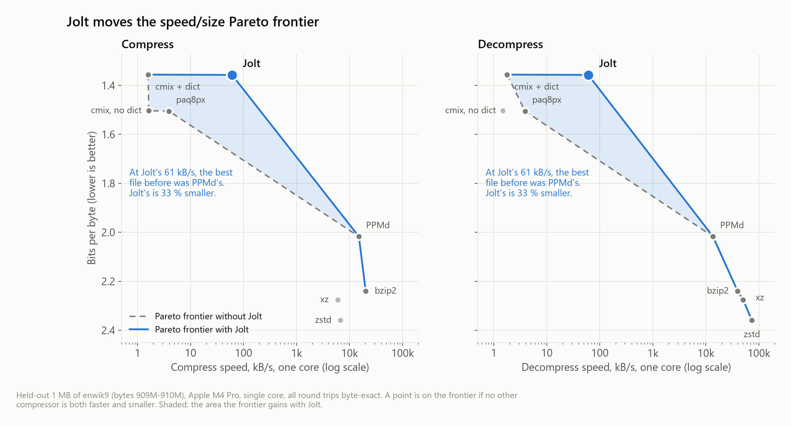

# ISA-NET: compressing Wikipedia with XOR, popcount and SDOT

ISA-NET is a neural lossless compressor whose predictor is built from the
instructions an Apple M4 core already has: `FCMGE` compares turn numbers into
bits, `EXT`/`BSL`/`EOR` run learned three-input logic on them, and `CNT` +
`SDOT` turn them back into numbers, around an INT8 `SDOT` attention backbone.
The published model, **Jolt**, is a 7,052,160-byte weight image that stays
resident in one performance core's L2 cache.

Blog post: [Compressing Wikipedia with XOR, Popcount and SDOT](https://dnhkng.github.io/posts/isa-net-compression/)
· Previous post: [Teaching an M4 CPU to Tell Stories with XOR, Popcount and SDOT](https://dnhkng.github.io/posts/m4-tinystories/)
([code](https://github.com/dnhkng/M4-TinyStories))



## Results

**Full enwik9** (1,000,000,000 bytes), exact round trip, Apple M4, four workers:

| | |
| --- | ---: |
| Compressed stream | 155,874,783 B (1.2470 bpb) |
| + zipped decompressor (model included) | **161,855,306 B (1.2948 bpb)** |
| Compress / decompress | 4,501 s / 4,522 s (about 220 kB/s) |

That would sit about 56th on the [Large Text Compression Benchmark](https://mattmahoney.net/dc/text.html).
**Jolt was trained on enwik9's first 900 MB**, so this number is corpus-tuned.

**Same machine, held-out text** (enwik9 bytes 909M-910M, never trained on),
Apple M4 Pro, one core, every round trip verified by SHA-256:

| Compressor | bpb | Compress kB/s | Decompress kB/s | Peak memory |
| --- | ---: | ---: | ---: | ---: |
| cmix v21 + dictionary | 1.3559 | 1.6 | 1.8 | 18.6 GB |
| **ISA-NET Jolt** | **1.3572** | **60.7** | **60.6** | **14 MB** |
| paq8px v217 -11L | 1.5051 | 3.9 | 3.9 | 8.8 GB |
| PPMd (7-Zip) | 2.0172 | 15,000 | 13,600 | 21 MB |
| xz -9e | 2.2758 | 6,000 | 50,600 | 75 MB |
| zstd -22 --long=30 | 2.3594 | 6,700 | 73,800 | 22 MB |

On 4 MB cmix pulls ahead (1.274 vs 1.352 bpb): it learns online, Jolt is a
frozen pretrained model. Full tables, protocol and caveats:
[bench/compare/results/REPORT.md](bench/compare/results/REPORT.md).

## Quick start (Apple M4, macOS)

Needs the Xcode Command Line Tools (Apple clang with `-mcpu=apple-m4`).

```sh
make build                              # -> build/isa-net-m4, about a minute
make roundtrip INPUT=some-file          # compress, decompress, compare
make check ENWIK9=path/to/enwik9        # reproduce the reference stream sizes exactly
```

```sh
build/isa-net-m4 compress-adaptive-fast  input  out.tli      # one worker
build/isa-net-m4 decompress-auto         out.tli restored
build/isa-net-m4 compress-parallel       input  out.tli4 --threads 4
build/isa-net-m4 decompress-parallel     out.tli4 restored --threads 4
```

`make check` compresses two held-out 1 MB slices of enwik9 and expects
exactly 169,645 and 180,600 bytes, the output of the original binary. The codec
is deterministic only between identical builds: `-ffast-math` and
`-mcpu=apple-m4` are part of the stream's numeric contract, and the stream
header carries a fingerprint so a mismatched decoder refuses to run.

## How it works

* **Model** (`native/`, `python/src/ternlog_vocab/model.py`): byte-level, 1,536-byte context, 4 blocks × 256 wide,
  8 heads with clipped-linear attention (no `exp`), INT8 `SDOT` projections stored as prepacked tickets,
  a 2,048-bit Boolean feed-forward program (3 rounds of learned LUT3 cells, `EOR`+`CNT`+`SDOT` decode),
  hashed n-gram embeddings for orders 3, 4 and 6, and a 64-bit Boolean vocabulary code with a rank-64 correction.
* **Codec** (`native/ternlog_byte_codec_m4.cpp`): the network's byte distribution is mixed with a
  64 KiB match model, then with the uniform distribution as an exact Bayesian posterior (a safety net for
  non-text input), quantised to 16-bit integer frequencies and coded with a 32-bit range coder.
  The four-worker mode splits the file into four independently coded lanes that share one copy of the weights.

## Repository layout

| Path | |
| --- | --- |
| `native/` | C++/NEON/assembly codec and inference kernels |
| `model/` | Jolt: exported layout header, 7 MB weight image, export manifest, training config, match-model mixing weights, corpus manifest |
| `scripts/compile.sh` | builds the codec from a header + weight image |
| `scripts/export.sh` | exports a PyTorch checkpoint into a header + weight image |
| `scripts/check.sh` | reproduces the reference stream sizes |
| `python/` | model definition, training loop and exporter (`pip install -e python`) |
| `configs/jolt.toml` | final-stage training configuration of Jolt |
| `bench/compare/` | the same-machine benchmark harness, its published results, and the chart script |

## Training

```sh
pip install -e python
ternlog-vocab prepare-bytes path/to/enwik9 data/enwik9_bytes \
    --validation-bytes 50000000 --test-bytes 50000000
ternlog-vocab train configs/jolt.toml
scripts/export.sh runs/jolt/best.pt model/match_mixing.json model-export
scripts/compile.sh model-export/ternlog_vocab_boolean_story_layout.h \
    model-export/ternlog_vocab_boolean_story_weights.bin build/my-model
```

Splits: bytes 0-900M train, 900M-950M validation, 950M-1000M test.
Jolt was trained (on an NVIDIA GH200) as a chain of resumed runs, about
3.2 billion decoded bytes in total, reaching 1.310 bpb on validation; `configs/jolt.toml`
is the final stage. The Jolt weights (`jolt-best-model.pt`, update 122284, model state only) are attached
to the [v1.0 release](https://github.com/dnhkng/ISA-NET/releases/tag/v1.0); re-exporting them with
`scripts/export.sh` reproduces `model/` byte for byte. The release also has the original
prebuilt macOS arm64 binary used for every number above.

## Reproducing the comparison

```sh
make build
cd bench/compare
python3 bench.py prepare --enwik9 path/to/enwik9
python3 bench.py env
python3 bench.py run smoke && python3 bench.py run quick && python3 bench.py run slices
python3 bench.py table
```

cmix v21 and paq8px aren't vendored: build them yourself and set their paths in
`bench_config.json` (created on first run). New results go to `results-local/`;
the published ones are in `results/`.

## Caveats

* Jolt is pretrained on enwik9[0:900M]; enwik8/enwik9 numbers are corpus-tuned. The comparison slices are held out.
* The 7 MB model is side information inside the binary; slice sizes don't count it, the enwik9 total does.
* The codec targets Apple M4 (`-mcpu=apple-m4`, NEON, `SDOT`, `FMLAL`). Other CPUs are not supported.

## License

MIT, see [LICENSE](LICENSE).

## Citation

```bibtex
@article{ng2026isanetcompression,
  title   = {Compressing Wikipedia with XOR, Popcount and SDOT},
  author  = {Ng, David Noel},
  year    = {2026},
  month   = {November},
  url     = {https://dnhkng.github.io/posts/isa-net-compression/}
}
```
